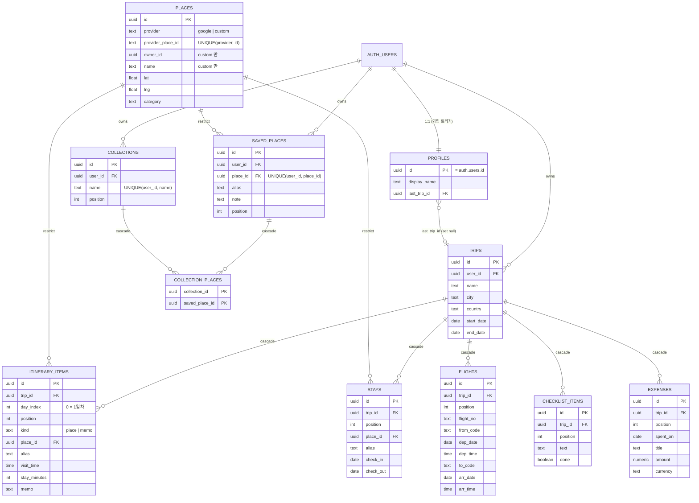

# 데이터베이스 설계 (Supabase PostgreSQL)

마이그레이션: `supabase/migrations/20261116000000_init.sql` · 타입: `src/lib/database.types.ts` (`npm run db:types` 로 재생성)

## ERD



모든 테이블에 `created_at` / `updated_at`(트리거로 자동 갱신)이 있습니다(`collection_places` 는 `created_at` 만).

## 설계 규칙

| 주제 | 결정 |
|---|---|
| 기본키 | 전부 UUID. 앱이 `crypto.randomUUID()` 로 미리 만들어 낙관적 업데이트와 맞춘다 |
| 날짜·시간 | 여행 날짜는 `date`, 방문·항공 시각은 **현지 벽시계 시각** `time`(타임존 없음). 일정의 실제 날짜 = `start_date + day_index` |
| 순서 | `position`(0부터) + `UNIQUE(trip_id, day_index, position)` |
| 중복 방지 | `places UNIQUE(provider, provider_place_id)`, `saved_places UNIQUE(user_id, place_id)`, `collections UNIQUE(user_id, name)` |
| 같은 장소 여러 날 | `itinerary_items` 는 장소를 FK 로 참조할 뿐이라 여러 날·여러 번 추가 가능 |
| 삭제 | 여행 삭제 → 자식 `cascade`. 일정·보관함이 참조 중인 장소는 `restrict`. 계정 삭제 → 전부 `cascade` |
| Google 데이터 | **Place ID 만 영구 저장**. 이름·주소·평점·좌표·리뷰는 저장하지 않고 열 때마다 조회 (약관 준수). `places_shape` CHECK 가 google 행에 다른 값이 들어가는 것을 막는다 |
| 직접 등록 장소 | `provider = 'custom'` + `owner_id` 로 구분 (스키마·RLS 준비됨, 화면은 아직 없음) |

## 쓰기 경로 (트랜잭션)

화면은 테이블에 직접 쓰지 않고 두 RPC 를 부릅니다. 둘 다 `security invoker` 라 호출자의 RLS 가 그대로 적용됩니다.

- `save_trip(p jsonb)` — 여행 한 건과 일정·항공·숙소·준비물·가계부를 **한 트랜잭션**으로 저장. 일정 이동·순서 변경이 중간 상태로 남지 않는다. 기간과 일차 수가 다르면 거부.
- `save_library(p_vault jsonb, p_collections jsonb)` — 보관함과 컬렉션을 한 번에 맞춘다(추가·수정·삭제).

## RLS 요약

| 테이블 | 정책 |
|---|---|
| `profiles` | 본인 행만 조회·수정 (생성은 가입 트리거, 삭제는 계정과 함께) |
| `trips`, `saved_places`, `collections` | `user_id = auth.uid()` 인 행만 (USING + WITH CHECK → 소유자 바꿔치기 불가) |
| `itinerary_items`, `flights`, `stays`, `checklist_items`, `expenses` | 부모 `trips` 의 소유자만 |
| `collection_places` | 컬렉션과 저장 장소가 **둘 다** 본인 것일 때만 |
| `places` | google 행: 로그인 사용자 조회·등록 가능, 수정·삭제 불가 / custom 행: 소유자만 |
| 비로그인(`anon`) | 모든 테이블 권한 회수. `ping()` 만 실행 가능 |

검증: `npm run test:rls` (사용자 A·B 분리 테스트 12건).

## 운영 DB 에 적용하기

```bash
npx supabase login
npx supabase link --project-ref <프로젝트 ref>
npx supabase db push          # 마이그레이션 적용 (새 테이블 생성뿐이라 기존 데이터를 지우지 않음)
npx supabase gen types typescript --linked > src/lib/database.types.ts
```
